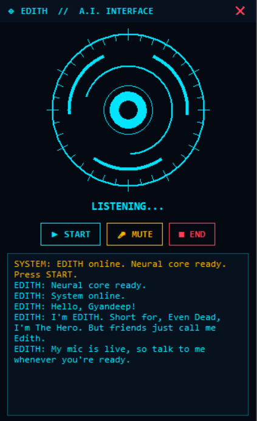

# EDITH: a free voice assistant with a Jarvis-style HUD

**Created by Gyandeep.**



EDITH is a tiny desktop voice assistant. She listens, thinks and talks back in a cheerful British voice, in English, Hindi/Hinglish and Assamese. She runs fine on a low-end PC, because all the heavy work happens online on free tiers, and your computer only records audio, plays sound and draws the HUD.

```
mic -> Groq Whisper (hears you) -> Groq Llama or Gemini (thinks) -> edge-tts (speaks)
```

## Features

- Movie-style boot intro, spoken out loud
- Animated arc-reactor HUD that reacts to your voice, with START, MUTE and END buttons
- No keys in the code: everyone uses their **own free keys** and gets their own free limit
- When a free limit is reached, she pauses, shows a countdown and resumes by herself
- Picks an available AI model automatically if one gets removed

## Setup

1. Install Python 3.10 or newer, then run: `pip install -r requirements.txt`
2. Copy `.env.example` to `.env` and fill in your key (see below).
3. (Optional) Run `python voice_test.py` to listen to different voices and test pronunciation.
4. Run: `python assistant_interface.py`
5. Click START and talk.

## Get the free keys

**Groq (required: hears you and, by default, thinks)**

1. Go to https://console.groq.com and sign up (Google, GitHub or email).
2. Open **API Keys**, click **Create API Key**, name it and copy it (starts with `gsk_`). It is shown only once.
3. Put it in `.env` as `GROQ_API_KEY=...`

**Gemini (optional: use instead of Groq for thinking)**

1. Go to https://aistudio.google.com and sign in with Google.
2. Click **Get API key**, then **Create API key**, and copy it (starts with `AIza`).
3. Put it in `.env` as `GEMINI_API_KEY=...` and set `LLM_PROVIDER=gemini`.
4. Do not enable billing on that project, or the free tier ends. A Google AI Pro subscription does not include API access.

## Tips

- Never upload your `.env` file. The included `.gitignore` already excludes it.
- If she can't hear you, lower `MIC_THRESHOLD` in `.env` (for example 300).
- Change her voice with `VOICE_EN`, `VOICE_HI` and `VOICE_AS` in `.env`. Run `edge-tts --list-voices` to see all voices.
- The intro and her personality can be edited in `assistant_core.py` (`intro_lines()` and `system_prompt()`).
- She can't be interrupted mid-sentence, and she can't browse the internet.

## Credits

Designed and built by **Gyandeep**. If you share or modify this project, please keep this credit and the LICENSE file.
EDITH's replies come from third-party language models (Groq / Gemini free tiers), and her voice comes from Microsoft's edge-tts voices.
